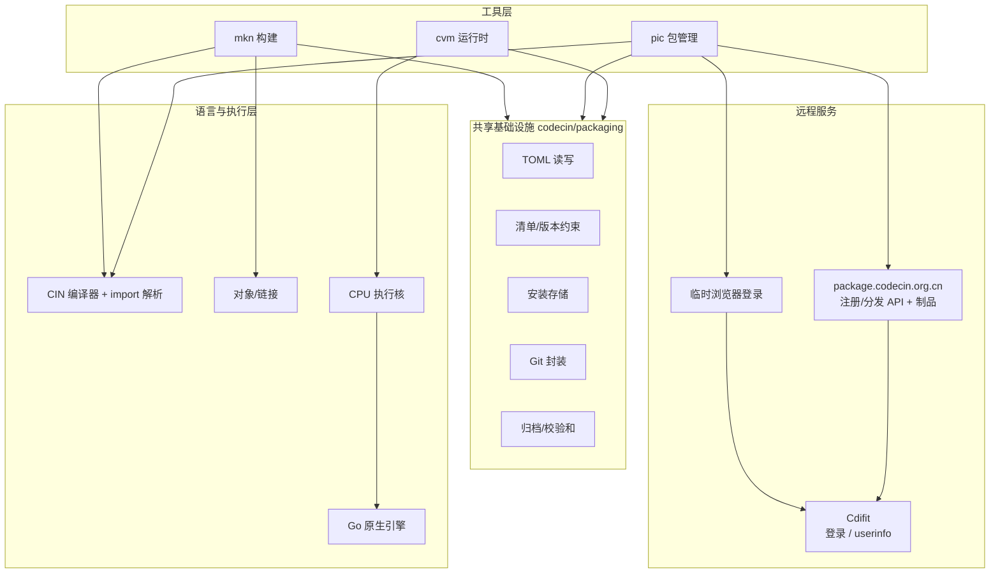

# Code CIN v6.2.0 开发计划：工具链生态

> 主题：**从"能编译运行"到"能构建、能分发、能部署"**。
> 本版本新增 `mkn`（Maven 风格构建工具）、`pic`（pip 风格包管理器，
> package.codecin.org.cn 中央注册/分发 + Cdifit 浏览器登录）、`cvm`
> （JVM 风格虚拟机/模块运行时），三者共享同一套清单、依赖解析与归档格式。

- 目标版本：`6.2.0`
- 计划日期：2026-10-23
- 交付形态：Python CLI（`mkn` / `pic` / `cvm`）+ 现有 Go 原生执行引擎 + Go 注册服务器 (`registry/`)
- 兼容基线：现有 `codecin` 命令与 `.cin/.pl/.asm/.bin/.crom/.co/.colib` 全部保持可用

---

## 1. 版本目标

v6.2.0 不改变 CIN 语言与 UCBC 指令集，重点补齐**工程化外围**：

1. **项目可构建**：一条命令完成依赖解析、编译、测试、打包、安装；
2. **包可自托管**：不依赖中心服务器，任何 Git 仓库都能作为包源；
3. **包可直接 import**：安装后的 CIN 包无需改源码即可 `import "pkg"`；
4. **产物可分发**：字节码 + 清单封装为 `.cvm` 模块，由 `cvm` 运行；
5. **概念升级**：对外运行时是 **CVM**（虚拟机），`CPU` 仅作为内部执行核。

### 非目标（本版本不做）

- 不实现真正的"运行时类加载/符号链接"（CIN 的 `import` 仍是编译期展开）；
- 不托管源码仓库、不做在线审核/账号管理（源码在 Git；中央服务器存元数据与制品）；
- 不改变 ABI v2、BIN v3、CROM v4 的二进制布局；
- 不把 `codecin` 改造成子命令式 CLI（保持 `codecin <program>` 的兼容入口）。

---

## 2. 三个工具

### 2.1 `mkn` —— Maven 风格项目构建

| Maven 概念 | mkn 对应 |
|---|---|
| `pom.xml` | `mkn.toml`（`[project]` / `[build]` / `[dependencies]`） |
| 标准目录 | `src/main.cin`、`src/test/**`、`target/`、`pic_modules/` |
| 生命周期 | `compile → test → package → install → deploy` |
| 依赖坐标 | `name@version` / Git 仓库 / 本地路径 |
| 本地仓库 | `$MKN_HOME/repository/<name>/<version>` |
| 传递依赖 | 统一解析到项目 `pic_modules/`，CIN 可直接 import |

命令矩阵：

```text
mkn new <name>                 创建标准项目
mkn init                       在当前目录初始化
mkn build | compile            编译；可执行项目 -> .bin，库项目 -> .co
mkn run -- <args>              编译并运行
mkn test                       运行 src/test/** 与 tests/**
mkn package                    生成 target/<name>-<version>.mkn
mkn install                    安装到本地 mkn 仓库
mkn deploy --repo <git-url>    安装后调用 pic publish
mkn add <name> ...             添加依赖（--version/--git/--tag/--local-path）
mkn tree                       打印传递依赖树
mkn verify                     校验清单、入口、依赖是否就绪
mkn clean [--deps]             清理 target/ 与 pic_modules/
```

设计要点：

- **库/应用自动判别**：入口及 import 闭包中无 `function main` 时按库项目编译为
  可重定位 `.co`（复用 `object.compile_cin_object`），不会因为缺少 `main` 失败；
- **依赖只有一个真相来源**：`mkn` 不重复实现包管理，路径/Git/注册表依赖全部调用
  `pic` 的内部 API，并写入 `pic_modules/` 与 `pic.lock`；
- **构建产物可复现**：`.mkn` 是确定性 zip，内含 `mkn.toml`、自动生成的 `pic.toml`、
  源码、`target/*.bin|.co` 与 `META-INF/SHA256SUMS`。

### 2.2 `pic` —— pip 风格包管理器

核心约定：**`package.codecin.org.cn` 保存元数据与制品；`www.cdifit.cn` 只负责登录。**

中央注册/分发服务器 (`https://package.codecin.org.cn/api/v1`) 存储：

* 标识名称；
* 包获取地址 (Git 仓库 URL)；
* 版本列表 (标签/提交/发布时间/是否 yank)；
* `.cinpkg` 制品 (可选, 由服务器分发)；
* 安全验证信息 (源码树 SHA-256、规范化清单 SHA-256、`.cinpkg` SHA-256、
  发布者身份、Git 提交)；
* 搜索/列表所需的名称索引。

```text
pic login                              启动临时本地 Web 服务, 浏览器登录 Cdifit
pic logout / whoami
pic init <name>                        创建 pic.toml + src/<name>.cin
pic build                              生成 dist/<name>-<version>.cinpkg
pic publish --repo <git-url> --name X  校验清单、打包、打标签、写入中央注册表
pic install <spec>                     安装 (全局或 --project)
pic install -e ./path --project        可编辑安装 (.pic-link)
pic uninstall / list / show / freeze
pic search                             搜索中央注册表 (离线时本地)
pic registry list                      列出中央注册包 (add/remove 为本地回退)
pic doctor
```

**首次登录**：`pic` 在 `127.0.0.1` 随机端口启动临时 Web 服务，打开浏览器；
用户在相对布局的登录页输入 Cdifit 邮箱/密码 (2FA 时显示验证码输入框)；
成功后写 `$PIC_HOME/auth.json` 并立即关闭服务。无 `auth.json` 时首次运行任意
`pic` 命令都会触发该流程 (登录/退出/诊断除外)；`PIC_OFFLINE=1` 可绕过。

登录页安全：只绑定 loopback、同源 `Origin` 校验、随机 CSRF token、
`Cache-Control: no-store`、`X-Frame-Options: DENY`；密码只在请求内存中。

安装规格：

| 形式 | 示例 |
|---|---|
| 名称 + 约束 | `pic install hello@^1.2` |
| Git 仓库 | `pic install git+https://github.com/u/cin-hello@v1.2.0` |
| 本地路径 | `pic install ../cin-hello --project` |
| 包归档 | `pic install dist/hello-1.2.0.cinpkg` |

按名称安装时：中央记录 → 选版本 → 下载 `.cinpkg` 并校验 SHA-256 (无制品则
Git 拉取标签/提交) → 重算源码/清单摘要 → 校验 `rev` → 任一不匹配则删除并拒绝。

存储布局（`PIC_HOME`，默认 `~/.pic`）：

```text
auth.json                           Cdifit 令牌 (0600)
config.toml                         api_base / registry.url / offline
index.json                          已安装记录 (原子写, 可自愈)
registry.json                       本地回退注册表 (PIC_OFFLINE)
packages/<name>/<version>/          包内容
packages/<name>/<version>/.pic-link 可编辑安装指针
cache/git/...                       Git 缓存 (本地仓库走复制, 远端走浅克隆)
cache/artifacts/...                 中央 .cinpkg 缓存
```

安全与确定性：

- 登录临时服务 + CSRF/Origin 校验，令牌文件 0600；
- 归档路径校验：拒绝绝对路径、盘符、`..`、符号链接成员；
- 每个归档带 `META-INF/SHA256SUMS`，安装/运行前校验；
- 中央记录带源码树/清单摘要与 Git 提交，安装后必须匹配；
- 包名、版本、入口路径在清单加载时统一校验；
- 安装过程不执行被安装包代码（只复制源码）。

### 2.3 `cvm` —— JVM 风格虚拟机

**概念切换**：对外不再称 "CPU 工具"，而是 **CVM（Code CIN Virtual Machine）**；
`CPU` 降级为内部执行核（寄存器/内存/指令分发），不再出现在用户命令中。

`.cvm` 模块（zip）：

```text
CVM-INF/MANIFEST.TOML     # [cvm] format/engine/abi, [module] name/version/main, [build]
code/program.bin          # UCBC BIN v3 字节码
META-INF/SHA256SUMS
```

命令矩阵：

```text
cvm build <src|project> [-o app.cvm]   从 CIN/BIN/mkn 项目构建模块
cvm run <module|file> -- <args>        运行模块
cvm inspect / verify                   查看清单 / 校验完整性
cvm install / which / list             安装到模块路径 / 解析模块 / 列出模块
cvm env                                显示引擎、ABI、模块路径
```

模块路径（类似 `CLASSPATH`）：

1. `CVM_MODULE_PATH`（`os.pathsep` 分隔）；
2. `$CVM_HOME/modules`（默认 `~/.cvm/modules`）。

与 JVM 的差异（有意为之）：

- 模块内是**已编译的 UCBC 字节码**，不是可跨 VM 版本演进的 class 文件；
- 模块之间不做运行期符号解析；CIN 的跨模块依赖在 `mkn/pic` 构建期已展开；
- CVM 负责"装载、校验、模块路径、执行"，编译仍由现有 CIN 编译器完成。

---

## 3. 清单格式

### `pic.toml`

```toml
[package]
name = "hello"
version = "1.2.0"
description = "..."
license = "MIT"
entry = "src/hello.cin"        # `import "hello"` 的入口
repo = "https://github.com/u/cin-hello"
tag = "v1.2.0"

[dependencies]
mathx = "^1.0"                 # 版本约束

[dependencies.jsonx]           # 或 Git / 本地路径
git = "https://github.com/u/cin-jsonx"
tag = "v2.1.0"
```

### `mkn.toml`

```toml
[project]
name = "app"
version = "0.1.0"
entry = "src/main.cin"

[build]
optimize = 0
backend = "vm"
mem_size = 1073741824

[dependencies]
libx = "0.1.0"

[dependencies.locy]
path = "../locy"
```

### 版本约束

支持 `*` / 精确 `x.y.z` / `^x.y.z` / `~x.y.z` / `>=`、`<=`、`>`、`<`、`!=` /
`1.x`、`1.2.x` / 逗号（AND）与 `||`（OR）。约束解析集中在
`codecin/packaging/model.py`，`pic` 与 `mkn` 共用。

---

## 4. 架构



`import` 解析优先级（v6.2.0 扩展，保持向后兼容）：

1. `./`、`../` 相对当前文件；
2. `codecin/lib/` 内置标准库（裸名字 `"math.cin"` 仍优先命中内置，避免兄弟文件劫持）；
3. 项目 `pic_modules/`、`.mkn/deps/`、`.pic/packages/`；
4. `CIN_PATH`；
5. 全局 `$PIC_HOME/packages/<name>/<current>`。

包名形式：

- `import "hello"` → 包入口（`pic.toml` 的 `entry`，回退 `src/hello.cin`）；
- `import "hello/util.cin"` → 包内文件；
- `import "hello.cin"` → 也允许命中名为 `hello` 的包（内置库优先）。

---

## 5. 里程碑

| 阶段 | 内容 | 状态 |
|---|---|---|
| M1 基础设施 | TOML、清单、版本约束、存储、Git、归档、安全解包 | ✅ 完成 |
| M2 包导入 | import 搜索路径、`pic_modules`、全局存储、错误提示 | ✅ 完成 |
| M3 pic | login/logout/whoami、中央注册表、浏览器登录、init/build/publish/install/uninstall/list/show/freeze/search/registry/doctor | ✅ 完成 |
| M4 mkn | new/init/build/run/test/package/install/deploy/add/tree/verify/clean | ✅ 完成 |
| M5 CVM | `.cvm` 格式、build/run/inspect/verify/install/list/env | ✅ 完成 |
| M6 发布 | CLI 入口、文档、CHANGELOG、版本号 6.2.0 | ✅ 完成 |

---

## 6. 验收标准

1. `mkn new demo && cd demo && mkn build && mkn run && mkn test` 全部返回 0；
2. `mkn package` 产物包含 `mkn.toml`、`pic.toml`、源码、字节码与校验和；
3. `mkn add lib --local-path ../lib` 后，`import "lib"` 能编译运行；
4. `pic login` 能启动临时 Web 服务；浏览器登录后 `auth.json` 存在且 `whoami` 可用；
5. `pic publish --repo ...` 生成 `.cinpkg`、创建标签，并向
   `package.codecin.org.cn` 写入元数据/上传制品；
6. `pic install name@^1.0` 能从中央注册表解析并安装；篡改注册表摘要后安装失败；
7. `pic install git+<本地仓库>@v1.0.0` 与本地路径安装仍可用（`PIC_OFFLINE=1`）；
8. 全局安装后，无 `CIN_PATH` 的普通 CIN 程序可直接 `import "name"`；
9. `cvm build app.cin` → `cvm verify` → `cvm run` 输出正确；
10. 篡改 `.cvm` 任一字节后 `cvm verify` 返回非 0；
11. 现有 `tests/test_features_import.py` 与 CLI 行为不回归；
12. `ruff check codecin tests` 通过。

---

## 7. 风险与应对

| 风险 | 应对 |
|---|---|
| 裸 `import "x.cin"` 命中第三方包导致旧程序行为变化 | 内置库永远优先；包名推荐无 `.cin` 后缀 |
| 同名包多版本 | 项目内 `pic_modules` 单版本；全局按 `current` 选择，可 `pic install name@ver` 切换 |
| Git 网络/凭据交互卡住 | 所有 Git 调用 `GIT_TERMINAL_PROMPT=0`；本地仓库走复制 + `reset --hard` |
| 中央注册服务器不可达/维护 | 明确报错，不静默降级；离线开发用 `PIC_OFFLINE=1`；本地回退注册表仍可用 |
| Cdifit 登录不可达 | 发布/按名称安装失败；`pic --offline` 仅本地开发，或稍后重试 |
| 中央注册表内容被篡改 | 安装后重算源码/清单摘要与 Git `rev`，不匹配即删除并拒绝 |
| 登录令牌泄露 | `auth.json` 0600；仅 loopback 临时服务；同源 + CSRF；令牌不落日志 |
| 浏览器无法打开 | `pic login --no-browser` 打印地址；或 `--email/--password` 直接登录 |
| 受限环境临时目录不可写 | 不使用 `tempfile.mkdtemp` 作为解包目录；在 `PIC_HOME/cache` 下用普通 `makedirs` 创建 |
| 包归档路径穿越 | 写/读双向校验成员名，拒绝绝对路径、盘符、`..`、符号链接 |
| `.cvm` 与引擎 ABI 不匹配 | 清单记录 `engine` / `abi`；运行前校验并给出明确错误 |
| 库项目没有 `main` | `mkn build` 自动产出 `.co`；`mkn run` 明确拒绝；`cvm build` 给出可理解错误 |

---

## 8. 交付物

- 新增：`codecin/mkn.py`、`codecin/pic.py`、`codecin/pic_api.py`、
  `codecin/pic_login.py`、`codecin/pic_registry.py`、`codecin/cvm.py`、
  `codecin/toolkit.py`；
- 新增：`registry/`（Go 中央注册/分发服务器：元数据、`.cinpkg` 制品、
  Cdifit Token 校验、yank、健康检查；含 `README.md`、systemd/nginx/Docker 部署）；
- 新增：`codecin/packaging/`（toml/model/store/vcs/archive）；
- 修改：`codecin/cin.py`（包 import 解析）、`pyproject.toml`（三个 console scripts）；
- 测试：`tests/test_v620_packaging.py`、`test_v620_import.py`、`test_v620_pic.py`、
  `test_v620_pic_git.py`、`test_v620_pic_registry.py`、`test_v620_mkn.py`、
  `test_v620_cvm.py`；
- 文档：本计划、README 工具链章节、`docs/tools/{mkn,pic,cvm}.md`；
- 版本：`6.2.0`（`codecin/__init__.py` 单一真源 + Go `BuildVersion` + CHANGELOG）。

---

## 9. 后续（6.3 候选）

- `mkn` 插件/自定义 goal 与并行构建；
- `pic` 增量索引（Git 索引仓库）与签名校验（minisign/Sigstore）；
- `cvm` 模块依赖元数据与运行期模块解析（真正的动态链接）；
- 远程构建缓存与可复现构建证明。
